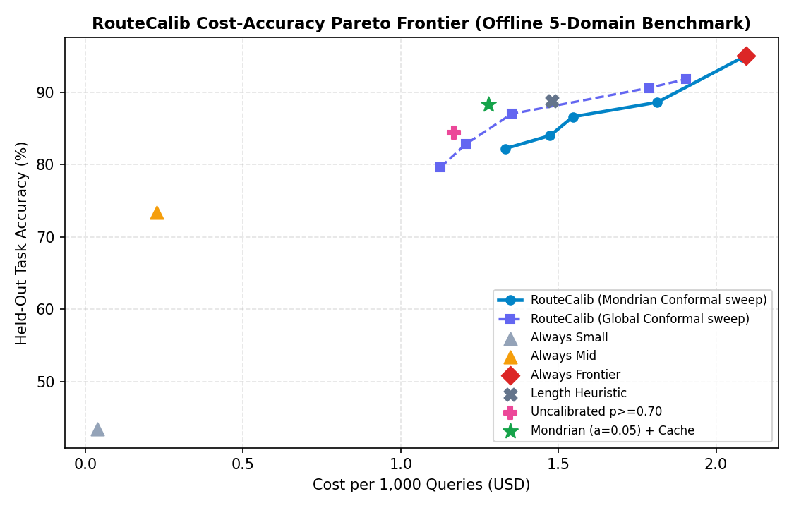
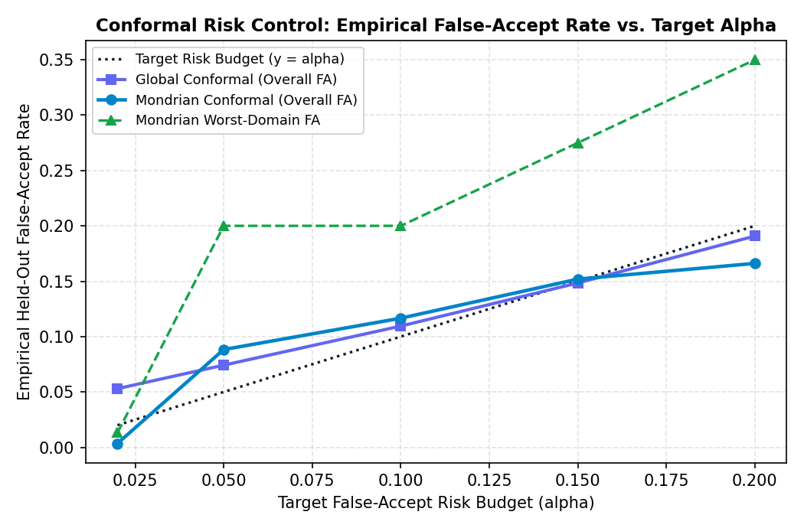
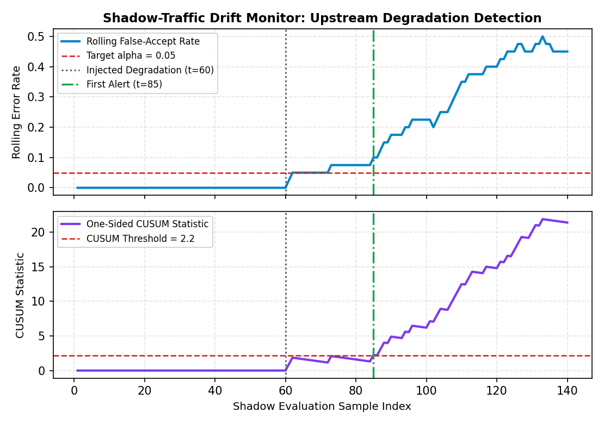

# RouteCalib — Conformal-Calibrated Multi-Model LLM Router

[](https://github.com/Eljo-M/routecalib/actions/workflows/ci.yml)
[](https://eljo-m.github.io/routecalib/)
[](#quickstart)

**RouteCalib** is a sub-millisecond, zero-GPU-dependency multi-model routing proxy and cost-quality control plane for LLM applications. It routes straightforward queries to fast small/local models and escalates hard queries to frontier models using **Global & Mondrian Split Conformal Prediction**, **hard latency/cost SLA enforcement**, a **numeric-guarded bounded semantic cache**, and a **CUSUM + Wilson shadow-traffic drift monitor**.

> **Live interactive website & conformal simulator:** `https://eljo-m.github.io/routecalib/` (served directly from `docs/index.html`)

## Architecture

```text
Prompt ─▶ [1. Numeric-Guarded Semantic Cache] ──(hit)──▶ $0.000 / <0.2ms Response
                   │ (miss)
                   ▼
          [2. 18-Feature Lexical/Structural Extractor (~0.08ms)]
                   │
                   ▼
          [3. Pure-NumPy Newton-IRLS Scorer + Temp Scaling] ──▶ P(pass | tier_k)
                   │
                   ▼
          [4. Mondrian Split Conformal Gate + Latency/Cost SLA]
                   ├──(accepted)──▶ Small (3B) / Mid (14B) ──(sample 10%)──▶ [5. Shadow CUSUM Drift Monitor]
                   └──(rejected)──▶ Frontier Reference
```

## Key Engineering Highlights

- **Sub-millisecond hot path (`routecalib/features.py`, `scorer.py`):** 18 deterministic difficulty features + pure-NumPy L2-regularized Newton-IRLS classifiers with held-out temperature scaling (`~0.21 ms` p95 routing overhead, zero embedding model required).
- **Finite-sample conformal risk control (`routecalib/conformal.py`):** Exact quantile `ceil((n_fail + 1)(1 - alpha)) / n_fail` over calibration failures bounds false-accept risk globally and per domain (`extraction`, `qa`, `reasoning`, `math`, `coding`).
- **Numeric-guarded semantic cache (`routecalib/cache.py`):** O(1) SHA-256 exact lookup + domain-scoped character-trigram cosine lookup with LRU eviction, TTL expiry, and a strict **numeric-literal equality guard** so `"invoice 104"` never collides with `"invoice 105"`.
- **Sequential drift detection (`routecalib/shadow.py`):** Samples cheap-tier calls against the frontier tier and combines a rolling **Wilson score lower bound** with a **one-sided CUSUM** change-point detector.
- **OpenAI-compatible proxy + interactive control plane (`routecalib/server.py`):** Zero-dependency `ThreadingHTTPServer` serving `POST /v1/chat/completions`, `GET /metrics`, `GET /health`, and a live interactive control plane at `GET /`.

## Offline Benchmark Results (`N=1,500`, `seed=42`)

Measured by `python -m routecalib.cli benchmark --out results --n-total 1500 --seed 42` on the deterministic 5-domain offline workload (`train=500`, `calibration=500`, `test=500`). Router overhead is real CPU wall-clock time; live endpoints connect via `OpenAICompatibleProvider`.

| Policy | Accuracy (%) | Cost / 1k Queries ($) | Savings vs. Frontier (%) | p50 Latency (ms) | Tier-0 False-Accept | Router p95 Overhead (ms) |
| :--- | ---: | ---: | ---: | ---: | ---: | ---: |
| `always_tier0_small` | 43.40% | $0.0378 | 98.20% | 221.4 | 1.0000 | 0.0100 |
| `always_tier1_mid` | 73.40% | $0.2267 | 89.18% | 521.6 | 0.0000 | 0.0100 |
| `always_tier2_frontier` | 95.00% | $2.0941 | 0.00% | 1215.5 | 0.0000 | 0.0100 |
| `heuristic_length` | 88.80% | $1.4788 | 29.38% | 675.6 | 0.0777 | 0.0200 |
| `uncalibrated_p70` | 84.40% | $1.1682 | 44.21% | 541.3 | 0.1060 | 0.0800 |
| **`routecalib_mondrian_a02`** | **94.80%** | $2.0843 | 0.47% | 1215.7 | **0.0035** | 0.2160 |
| **`routecalib_mondrian_a05`** | **88.60%** | $1.8136 | 13.40% | 1131.1 | 0.0883 | 0.2147 |
| **`routecalib_mondrian_a10`** | **86.60%** | $1.5462 | 26.17% | 884.1 | 0.1166 | 0.2146 |
| **`routecalib_mondrian_a05_cached`** | **88.34%** | **$1.2786** | **38.48%** | **682.6** | 0.0876 | 0.1500 |





## Quickstart

```bash
pip install numpy matplotlib
python -m unittest discover -s tests -v
python -m routecalib.cli benchmark --out results --n-total 1500 --seed 42
python -m routecalib.cli serve --host 127.0.0.1 --port 8080
```

Open **`http://127.0.0.1:8080`** to use the live interactive routing control plane.

## Limitations & Scope

- Offline benchmark figures evaluate the routing, conformal calibration, caching, and drift-detection stack on a deterministic 5-domain workload rather than live commercial APIs; live endpoints plug in via `OpenAICompatibleProvider`.
- Finite-sample conformal guarantees rely on exchangeability between calibration and test distributions; under distribution shift or upstream degradation, `ShadowEvaluator` surfaces drift alerts so operators can recalibrate.
